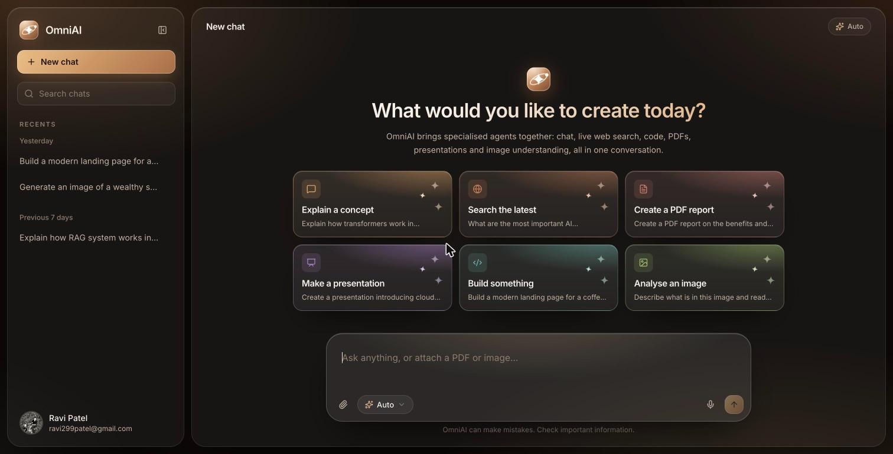
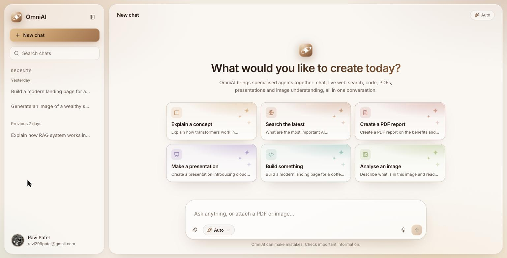
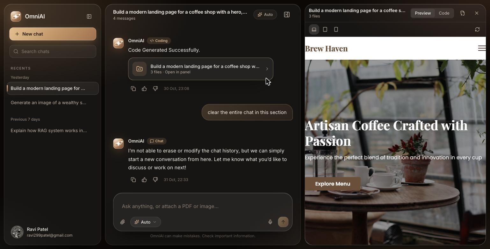
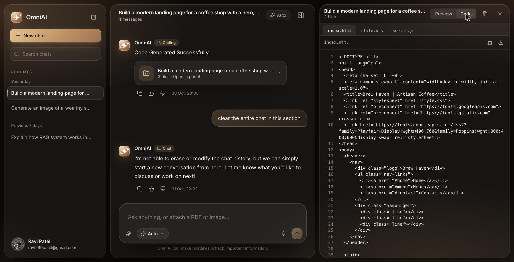
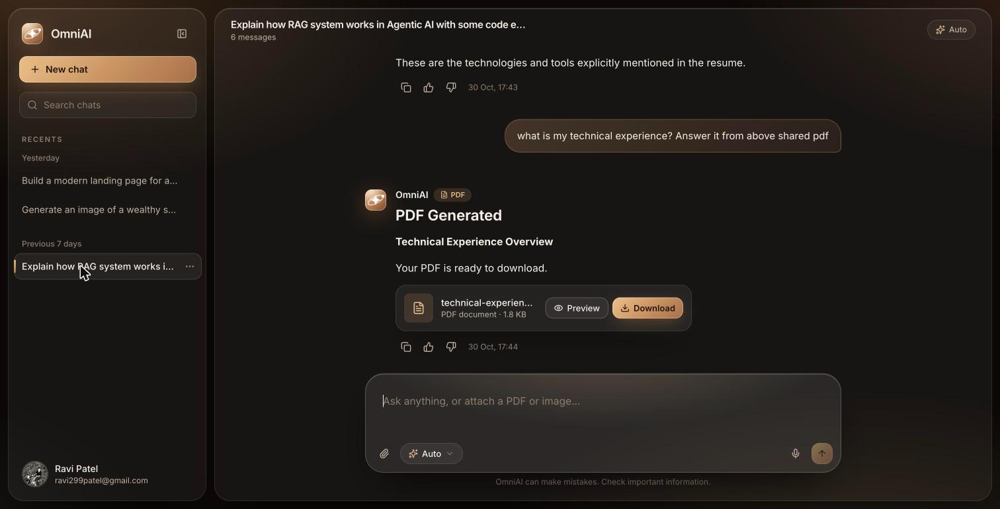
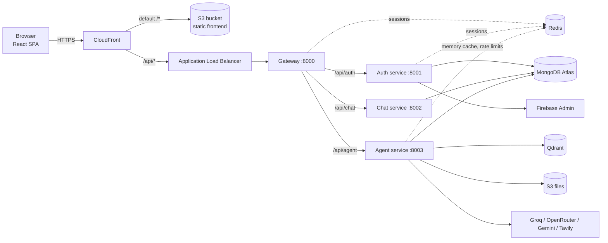
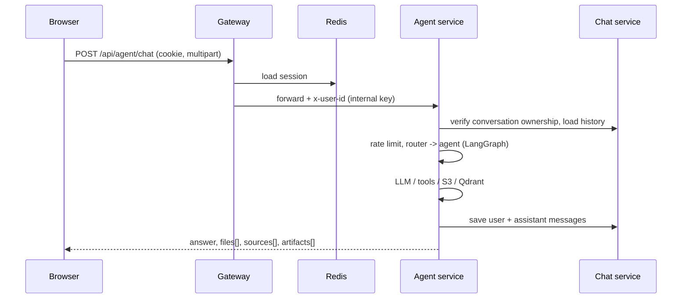

# OmniAI

A multi-agent AI workspace in one chat. Ask a question, search the live web, generate a website, build a PDF or a slide deck, create an image, or upload a PDF/image and talk to it. An LLM router picks the right agent, or you pick one yourself.

**Live demo:** https://d2amk40pjfc3q4.cloudfront.net



## Highlights

- **Seven agents behind one chat box**: Chat, Search, Coding, PDF, PPT, Vision, plus file-aware PDF Q&A and image analysis. `Auto` mode classifies the prompt and routes it with a LangGraph state graph.
- **Live code workspace**: generated multi-file projects open in a side panel with a sandboxed live preview (desktop/tablet/mobile widths) and a CodeMirror code view.
- **Downloadable artifacts**: PDFs and PowerPoint decks are generated server-side, stored in S3 and served through short-lived presigned URLs.
- **RAG over your PDF**: uploaded PDFs are chunked, embedded and stored in Qdrant (one collection per conversation), then retrieved to answer questions.
- **Microservices on AWS**: four Node services on ECS Fargate behind an ALB, a single CloudFront distribution serving both the SPA and the API, deployed by GitHub Actions.
- **Careful security model**: Firebase sign-in exchanged once for an httpOnly Redis-backed session cookie, per-user ownership checks on every conversation, per-agent rate limits, upload validation and a sandboxed preview iframe.
- **Apple-style glass UI** with a coffee palette, light and dark themes, motion, and a fully responsive layout.

## Screenshots

| Light theme | Dark theme |
|---|---|
|  |  |

| Coding agent: live preview | Coding agent: code view |
|---|---|
|  |  |

**PDF generation** with an inline download card:



## Agents

| Agent | What it does | Backed by |
|---|---|---|
| Chat | Conversational answers with the last 20 messages as memory | Groq `openai/gpt-oss-120b` |
| Search | Live web search with sources and images, then a grounded answer | Tavily + Groq |
| Coding | Generates multi-file projects as artifacts (or explains code) | OpenRouter `deepseek/deepseek-chat` |
| PDF | Generates a formatted PDF report from a topic | PDFKit + S3 |
| PPT | Generates a slide deck | PptxGenJS + S3 |
| Vision | Generates an image from a prompt, or analyses an attached image | Gemini 2.5 Flash, pollinations.ai |
| PDF Q&A | Answers questions about an uploaded PDF (RAG) | Gemini embeddings + Qdrant |

With `Auto`, an attached PDF or image routes to its file-aware agent, and any other prompt is classified by an LLM router (unknown output falls back to Chat).

## Architecture



**Same-origin design.** One CloudFront distribution serves the static files from a private S3 bucket (origin access control) and forwards `/api/*` to the ALB. The browser only ever talks to one origin, so there is no CORS, and the `SameSite=Strict` session cookie stays first-party.

**Request flow for a chat message**



**Authentication.** The browser signs in with Firebase (Google) and sends the ID token once to `POST /api/auth/login`. The auth service verifies it with Firebase Admin, upserts the user, and creates a random session id stored in Redis for 7 days. The browser receives an httpOnly cookie. The gateway resolves the cookie to a user on every request and forwards `x-user-id` to the internal services, which also require a shared `INTERNAL_API_KEY`.

## Tech stack

| Layer | Technologies |
|---|---|
| Frontend | React 19, TypeScript (strict), Vite, Tailwind CSS v4, TanStack Query, React Router 7, Motion, Radix UI, CodeMirror 6, react-markdown + highlight, Firebase Auth (client) |
| Backend | Node.js 24, Express 5, Mongoose, ioredis, multer, morgan, cookie-parser |
| AI | LangGraph, LangChain (Groq, OpenRouter, Google GenAI, Qdrant, Tavily), Gemini embeddings |
| Data | MongoDB Atlas, Redis (ElastiCache), Qdrant Cloud, S3 |
| Infra | Docker (multi-stage, non-root), ECR, ECS Fargate, ALB, CloudFront + Origin Access Control, Secrets Manager, ACM-ready, IAM |
| CI/CD | GitHub Actions: build images, push to ECR, roll ECS services, sync S3, invalidate CloudFront |
| Testing | Vitest, Testing Library, MSW (strict mode), ESLint, `tsc --noEmit` |

## Repository layout

```
backend/
  gateway/            public entry: auth session check, proxies, health, CORS
  services/
    auth/             Firebase verify, users, sessions
    chat/             conversations and messages (ownership, pagination, feedback)
    agent/            LangGraph router, agents, S3, Qdrant, rate limits
  shared/             Redis client, error contract, cookie options, internal auth
  docker-compose.yml  local Redis
frontend/
  src/                components, contexts, hooks, API client, pages
  tests/              88 unit and component tests
  Dockerfile, nginx.conf   optional container build of the SPA
.github/workflows/    CI/CD pipeline
docs/screenshots/     images used in this README
BACKEND_AUDIT.md      security and correctness audit with fixes and API contract
FRONTEND_PLAN.md      frontend design decisions
```

## API overview

All routes go through the gateway and require the `session` cookie unless marked public. Errors always use `{ success: false, code, message }` with a real status code (401 unauthenticated, 429 with `retryAfter` for rate limits).

| Method and path | Purpose |
|---|---|
| `POST /api/auth/login` (public) | Exchange a Firebase ID token for a session cookie |
| `POST /api/auth/logout` | Delete the session |
| `GET /api/user` | Restore the session |
| `GET /api/chat/get-conversation` | List conversations (`limit`, `before`, `q` for title search) |
| `POST /api/chat/create-conversation` | Create a conversation |
| `GET /api/chat/get-messages/:conversationId` | Messages oldest to newest, paginated |
| `POST /api/chat/update-conversation` | Rename |
| `DELETE /api/chat/delete-conversation/:id` | Delete |
| `POST /api/chat/feedback` | Thumbs up/down on an assistant message |
| `POST /api/agent/chat` | Run an agent (`multipart`: prompt, conversationId, agent, optional file) |
| `GET /api/agent/file-url` | Fresh presigned URL for a stored file |

Full contract, findings and verification notes are in [`BACKEND_AUDIT.md`](BACKEND_AUDIT.md).

## Run locally

Prerequisites: Node 22+ (developed on 24), Docker (for Redis), a MongoDB database, and accounts or keys for Firebase, Groq, OpenRouter, Gemini, Tavily, Qdrant and an S3 bucket.

```bash
# 1. Redis
cd backend && docker compose up -d redis

# 2. Services: copy each .env.example to .env and fill it in, then in four terminals
cd backend/gateway && npm ci && npm start          # :8000
cd backend/services/auth  && npm ci && npm start   # :8001
cd backend/services/chat  && npm ci && npm start   # :8002
cd backend/services/agent && npm ci && npm start   # :8003

# 3. Frontend (Vite proxies /api to the gateway, so cookies work with no CORS setup)
cd frontend && cp .env.example .env   # add the VITE_FIREBASE_* values
npm ci && npm run dev                  # http://localhost:5173
```

Never commit `.env` files or the Firebase service-account JSON; both are git-ignored and excluded from Docker images.

### Environment variables (names only)

| Service | Variables |
|---|---|
| Gateway | `PORT`, `AUTH_SERVICE`, `CHAT_SERVICE`, `AGENT_SERVICE`, `FRONTEND_URL`, `REDIS_URL`, `INTERNAL_API_KEY` |
| Auth | `PORT`, `MONGO_URL`, `REDIS_URL`, `FIREBASE_SERVICE_ACCOUNT_BASE64`, `INTERNAL_API_KEY`, `COOKIE_SECURE` |
| Chat | `PORT`, `MONGO_URL`, `INTERNAL_API_KEY` |
| Agent | `PORT`, `MONGO_URL`, `CHAT_SERVICE`, `REDIS_URL`, LLM and search keys, AWS S3 settings, `QDRANT_URL`, `QDRANT_API_KEY`, `INTERNAL_API_KEY` |
| Frontend | `VITE_FIREBASE_API_KEY`, `VITE_FIREBASE_AUTH_DOMAIN`, `VITE_FIREBASE_PROJECT_ID`, `VITE_FIREBASE_APP_ID` (leave `VITE_API_BASE` empty for same-origin) |

## Testing

```bash
cd frontend
npm test            # 88 tests (Vitest + Testing Library + MSW in strict mode)
npm run typecheck   # strict TypeScript
npm run lint
```

Frontend coverage includes the API client (cookies, 401 handling, timeouts, abort, multipart), authentication and protected routes, session expiry, the chat flows (send, retry, rate limit, attachments, artifacts), the sidebar, Markdown rendering (including XSS cases), and the artifact panel with the sandbox/CSP builder.

The backend was verified with scripted end-to-end checks through the gateway (61 HTTP checks covering auth, ownership between two users, pagination, search, upload limits and logout) plus unit checks for rate limiting, routing and parsing. A committed backend test suite is still on the to-do list.

## Deployment

Everything runs in `ap-southeast-2`.

1. **Images**: each service has a multi-stage Dockerfile (`node:24-slim`, `npm ci`, non-root user). Build with `backend/` as the context and push to ECR (`gateway`, `auth-service`, `chat-service`, `agent-service`).
2. **Runtime**: one ECS Fargate service per image behind an ALB. Secrets (database URLs, API keys, the base64 Firebase service account) come from **Secrets Manager** through the task definition; the ALB idle timeout is 180 s because AI replies are not streamed.
3. **Edge**: a single CloudFront distribution. The default behaviour serves the SPA from a private S3 bucket (Origin Access Control) with a small CloudFront Function for client-side routes; `/api/*` forwards to the ALB with caching disabled. The ALB security group is meant to accept only CloudFront's managed prefix list, so the load balancer is not reachable directly.
4. **Frontend release**: `npm run build`, upload `dist/` to S3 (immutable cache for hashed assets, `no-cache` for `index.html`), invalidate CloudFront.
5. **CI/CD**: [GitHub Actions](.github/workflows/deploy.yml) builds and pushes the four images, forces a new ECS deployment per service, builds the frontend and publishes it. AWS credentials come from repository secrets and use a dedicated, narrowly scoped deploy user.

## Security notes

- Firebase ID tokens are verified server-side once; the app uses an httpOnly, `SameSite=Strict`, `Secure` session cookie backed by Redis (7 days), with logout deleting the session.
- Every conversation and file operation checks that the resource belongs to the caller. Internal services require a shared key and are not exposed publicly.
- Uploads are limited to PDF, JPEG, PNG, WebP, GIF and HEIC up to 20 MB; prompts, ids, titles and array sizes are validated.
- Per-user, per-agent rate limits live in Redis (for example Chat 20/min, Coding and Search 5/min).
- Generated HTML runs in `<iframe sandbox="allow-scripts">` without `allow-same-origin`, with an injected Content-Security-Policy that blocks network requests. Markdown never renders raw HTML.
- Secrets never enter images or the repository.

## Known limitations

- No response streaming yet: replies appear when complete, with staged progress and a Stop button.
- No message regeneration or editing.
- Image generation uses the free pollinations.ai endpoint, with no SLA.
- Deleting a conversation does not yet remove its S3 objects or Qdrant collection.
- Backend automated tests are not committed yet.

## License

Personal portfolio project.
